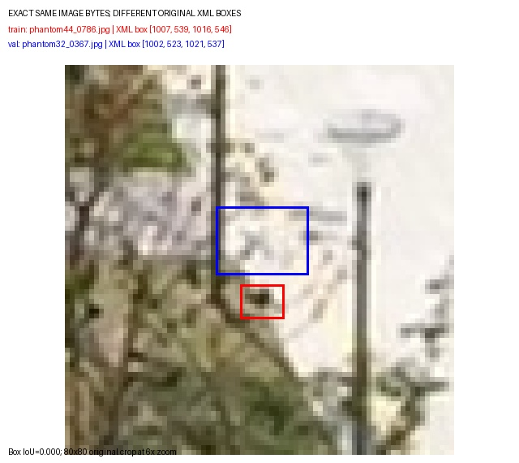
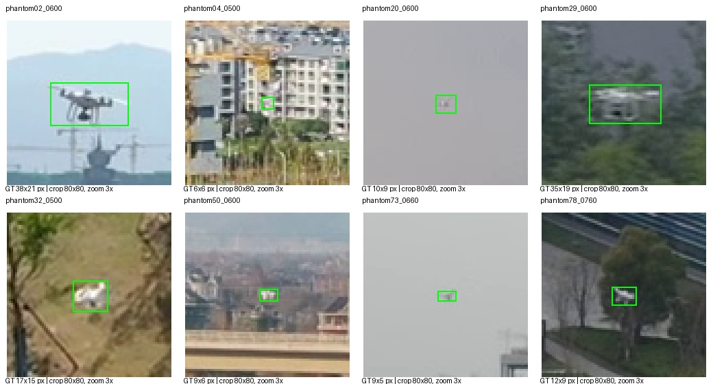

# ARD-MAV 数据集检查

检查及清理日期：2026-10-23（Asia/Shanghai）。数据集：
`/home/ake/SJTU/graduation-project/dataset/ARD-MAV-YOLO`。
原始数据：`/home/ake/SJTU/graduation-project/dataset/ARD-MAV`。
初次检查记录保存在 `checks.json` 和 `duplicate_frames.json`，其中数量及路径反映清理前状态。
随后按用户要求删除了训练集重复图片及对应标签，没有启动训练。

## 当前状态：已删除 780 对训练图片和标签

- 删除训练集 `phantom44_0420` 至 `phantom44_1199` 的 780 张图片及 780 个对应标签。
- 保留验证集 `phantom32_0001` 至 `phantom32_0780`，验证集、测试集及原始视频/XML 未修改。
- 训练集由 64,713 对减少为 **63,933 对**；验证集仍为 14,447 对，测试集仍为 28,337 对，共 106,717 对。
- 删除 `labels/train.cache`，下次训练时会重新生成。
- 复查全部 106,717 张图片及对应标签，无缺失配对；对全部跨集合等大小候选计算 SHA-256，完全相同的跨集合图片为 0 组。
- 原检查发现的 52 个边缘框问题另行保留，本次只处理重复数据。

删除记录及清理后的复查结果见 [deduplication.json](deduplication.json)。下文保留初检发现作为历史证据。

## 初检结论（清理前）

存在需要处理的问题：**训练集与验证集有重叠视频画面，而且同一画面的原始标注不完全一致**。
当前按视频编号划分虽然没有编号重叠，仍不足以保证底层视频片段相互独立。
不能直接将上一轮训练异常全部归因于这一个问题。

## 主要问题：780 对训练/验证重复帧

全量检查图片文件大小，并对所有跨划分的相同大小候选执行 SHA-256，发现 780 对 JPEG 内容完全相同的图片。
涉及训练集 780 张和验证集 780 张，占验证集 14,447 张图片的约 5.40%。

- 训练集：`phantom44_0420.jpg` 至 `phantom44_1199.jpg`。
- 验证集：`phantom32_0001.jpg` 至 `phantom32_0780.jpg`。
- 对应关系：`phantom44` 帧号 = `phantom32` 帧号 + 419，整段 780 帧均相同。
- 从原始视频重新解码重叠段起点、中点、终点，也确认画面相同。因此重叠来自原始视频，而非转换串帧。
- 本次没有检测到涉及测试集的完全相同 JPEG。SHA-256 不能排除重新压缩后或视觉上近似的其他重叠。

其中 768 对图片的框标注不同，111 对框的 IoU 低于 0.5，238 对低于 0.75，最小 IoU 为 0。
这些 YOLO 标签都与各自的原始 XML 一致，所以差异来自原始标注。
同一张画面在训练和验证中获得不同监督，会影响训练及定位评估；重复帧本身还破坏了验证独立性。

示例：`train/phantom44_0786.jpg` 与 `val/phantom32_0367.jpg` 完全相同，两个标注框不相交。

[完整 780 对帧清单及框 IoU](duplicate_frames.json)。

## 较小问题：52 个边缘框约越界 1 像素

训练集 34 个、验证集 1 个、测试集 17 个框，在还原像素边界后有约 1 像素的左侧或上侧越界。
原 XML 存在 `xmin=0` 或 `ymin=0`，当前 VOC 转换按中心坐标减 1，导致这些框的边缘落到约 -1。
所有标签的中心、宽高仍满足当前 YOLO 格式检查，缓存没有将它们判为损坏。
建议复核原标注坐标约定，并在转换处将边缘框裁剪到图像范围；这不是上一轮指标大幅崩落的充分解释。
详细文件名与坐标见 [checks.json](checks.json) 的 `labels_and_splits.edge_cases`。

## 初检已通过的检查（清理前）

- 图片/标签共 107,497 对：训练 64,713、验证 14,447、测试 28,337。
- 37/8/15 个视频，划分名单覆盖全部 60 个原始视频，与 seed 0 的当前配置一致。
- 无缺失图片、缺失标签、缺失原始 XML、额外转换帧、非有限数字、非法类别或非正宽高。
- 全量 YOLO 框与原始 XML 转换结果一致，没有重复标签行。
- 全量 JPEG 的文件头/结构、尺寸、RGB 通道及结束标记通过，尺寸均为 1920×1080。
- 覆盖全部 60 个视频的 240 帧抽样：重新解码并编码后，与保存的 JPEG 字节一致，未发现转换错帧。
- 训练/验证 `.cache` 的哈希、路径、图片数量和缓存标签均与检查时的文件一致，没有过期缓存证据。
- 1,059 个空标签样本与原始空 XML 对应，是背景帧，不是漏写标签。

图片检查没有对全部 JPEG 逐像素解码；实际解码覆盖上述抽样。没有对全部目标进行人工语义复核。

## 小目标难度仍然突出

按原始 1920×1080 图像等比缩放到宽 640 估算，不含随机增强：

- 训练集框宽/高中位数约 4.67×3.33 像素，70.23% 的目标长边不足 8 像素。
- 验证集约 4.33×3.33 像素，82.43% 的目标长边不足 8 像素。
- 测试集约 5.00×3.33 像素，71.35% 的目标长边不足 8 像素。

这属于数据难度和缩放的信息损失，不等同于格式损坏。P2 或切片方法应在修复划分后评估。

## 后续使用

原始视频/XML 仍包含重叠片段，现有 `prepare.py` 全量重新转换会再次生成这些帧，届时需重新执行上述删除。
`splits.yaml` 仍记录视频所属集合，训练集 `phantom44` 现在只保留第 1 至 419 帧。
若重新设计划分，应把 `phantom32` 和 `phantom44` 视为同一来源的视频组。

已有基线结果使用清理前的数据；新实验使用清理后的数据，因此与旧基线的差异同时包含数据清理的影响。
52 个边缘框仍需另行核对原始坐标约定，不能将本次去重等同于全部标注质量问题已修复。
